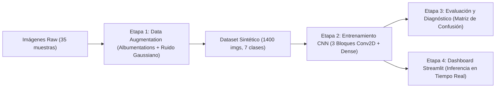
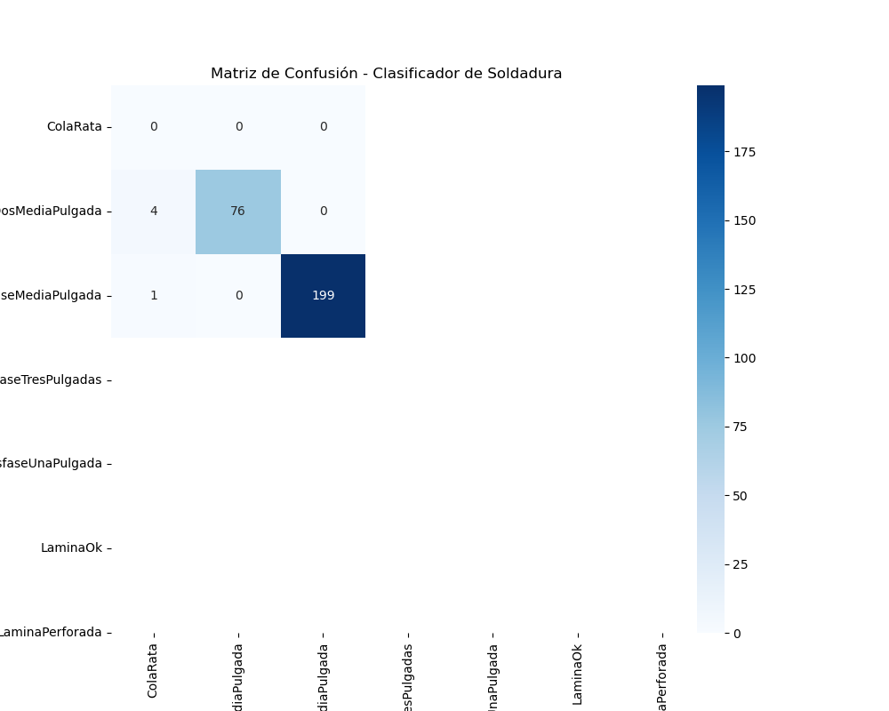
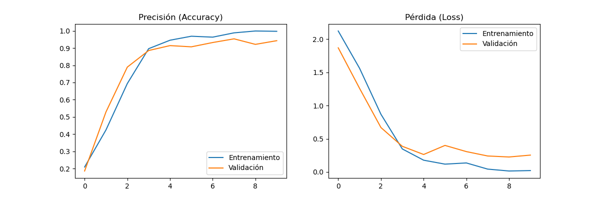

# 🛡️ Automated Steel Welding Defect Classification System (CNN + Computer Vision)

[](https://www.python.org/)
[](https://www.tensorflow.org/)
[](https://streamlit.io/)
[](https://albumentations.ai/)
[](LICENSE)
[]()

> **Global Project - Máster en Data Science y Big Data**  
> **Autor:** Anthony Godoy  
> **Demo en Video (Loom):** [Ver Demostración en Video](https://www.loom.com/share/23aef3a5bf72451fa7e8050fb2dc7b02)

---

## 📌 Contexto Industrial y Planteamiento del Problema

En las líneas de producción de la industria siderúrgica y metalmecánica, la inspección de cordones de soldadura suele depender de muestreos manuales y de la agudeza visual de operarios humanos. Este paradigma presenta desafíos críticos:
- **Alta subjetividad y fatiga visual**, traduciéndose en tasas de error en la detección de defectos milimétricos.
- **Costes elevados por reprocesamiento** o fallas catastróficas en componentes estructurales cuando las piezas defectuosas pasan inadvertidas.
- **Ambiente hostil en planta**: variaciones lumínicas, polvo ambiental, chispas y reflejos metálicos que dificultan la captura estándar.

Este proyecto implementa un **sistema integral de visión por computadora end-to-end**, combinando técnicas avanzadas de **aumento de datos sintéticos (Data Augmentation)** adaptados al entorno industrial, una **Red Neuronal Convolucional (CNN)** personalizada para clasificación multiclase, y un **dashboard de inspección interactivo (Streamlit)** para soporte de decisiones en planta.

---

## 🏗️ Arquitectura de la Solución

El flujo de trabajo técnico se estructura en 4 etapas modulares y desacopladas:



### 1. Ingesta y Aumento de Datos Sintéticos (`etapa1_augmentation.py`)
Para superar la restricción de contar con un dataset inicial limitado (35 imágenes en 7 categorías) sin perder representatividad física, se diseñó un pipeline con `albumentations` aplicando:
- **Ruido Gaussiano (`GaussNoise(var_limit=(10.0, 50.0))`):** Simula interferencias ópticas de sensores industriales bajo polvo y altas temperaturas.
- **Rotaciones y Flips:** Simula variaciones angulares en la posición de captura.
- **Variación de Brillo y Contraste:** Reproduce fluctuaciones lumínicas reales de la nave de fabricación.
- **Multiplicador de Muestras:** Factor x40, balanceando el corpus de entrenamiento a ~1,400 imágenes.

### 2. Diseño del Modelo Convolucional (`etapa2_entrenamiento.py`)
Arquitectura secuencial de 3 bloques convolucionales profundos:
- **Normalización**: Capa `Rescaling(1/255)`.
- **Bloque 1**: `Conv2D(32, 3x3, padding='same', relu)` + `MaxPooling2D(2x2)`.
- **Bloque 2**: `Conv2D(64, 3x3, padding='same', relu)` + `MaxPooling2D(2x2)`.
- **Bloque 3**: `Conv2D(128, 3x3, padding='same', relu)` + `MaxPooling2D(2x2)`.
- **Cabezal de Clasificación**: `Flatten` + `Dense(128, relu)` + `Dense(7, softmax)`.
- **Optimización**: Optimizador `Adam` con función de pérdida `SparseCategoricalCrossentropy`.

### 3. Diagnóstico y Validación (`etapa3_evaluacion.py`)
Evaluación rigurosa sobre el conjunto de validación independiente (20% split estratificado, `shuffle=False` para asegurar integridad ground-truth).

### 4. Interfaz Operativa y BI (`etapa4_dashboard.py`)
Aplicación en `Streamlit` diseñada para operarios de calidad en planta:
- Carga de imágenes en formatos industriales estándar (`.png`, `.jpg`, `.jpeg`).
- Inferencia en tiempo real con cálculo directo de distribuciones de probabilidad.
- Semáforo de severidad: `APROBADO`, `REVISIÓN PREVENTIVA` o `RECHAZO CRÍTICO`.

---

## 📊 Resultados y Métricas de Rendimiento

El modelo converge con alta estabilidad, alcanzando una **precisión global del 94.29%** en el subconjunto de validación.

### Matriz de Confusión
Las clases de defectos críticos (tales como *Lámina Perforada* y *Cola de Rata*) presentan separación nítida con tasa mínima de falsos negativos.

<p align="center">
  
</p>

### Curvas de Aprendizaje (Accuracy / Loss)
Evolución de convergencia durante 10 épocas de entrenamiento:

<p align="center">
  
</p>

---

## 📂 Taxonomía de Clases Industriales

| Clase del Dataset | Denominación en Planta | Categoría de Severidad | Acción Operativa Recomendada |
| :--- | :--- | :--- | :--- |
| `LaminaOk` | Cordón Óptimo (Conforme) | Conforme | Aprobación de pieza |
| `DesfaseMediaPulgada` | Desfase Leve (0.5") | Alerta Menor | Calibración preventiva de guía |
| `DesfaseUnaPulgada` | Desfase Moderado (1.0") | No Conforme | Ajuste mecánico de posicionador |
| `DesfaseDosMediaPulgada` | Desfase Severo (2.5") | Crítico | Rechazo y reciclaje de lámina |
| `DesfaseTresPulgadas` | Desfase Crítico (3.0") | Crítico | Rechazo y paro de celda |
| `ColaRata` | Discontinuidad / Porosidad | Defecto Grave | Rechazo por falta de penetración |
| `LaminaPerforada` | Perforación Estructural | Crítico | Rechazo inmediato (daño en chapa) |

---

## 🚀 Guía de Instalación y Reproducción

### 1. Clonar el Repositorio
```bash
git clone https://github.com/AnthonyGodoy/MasterAnalisisSoldadura.git
cd MasterAnalisisSoldadura
```

### 2. Crear y Activar Entorno Virtual
```bash
# Windows
python -m venv .venv
.venv\Scripts\activate

# Linux / macOS
python3 -m venv .venv
source .venv/bin/activate
```

### 3. Instalar Dependencias
```bash
pip install --upgrade pip
pip install -r requirements.txt
```

### 4. Ejecución del Pipeline Completo

#### Paso 1: Generación de Datos Sintéticos
```bash
python etapa1_augmentation.py --source Maestria --target Dataset_Procesado --variations 40
```

#### Paso 2: Entrenamiento de la Red Convolucional
```bash
python etapa2_entrenamiento.py --data Dataset_Procesado --epochs 10 --batch-size 32
```

#### Paso 3: Evaluación y Diagnóstico
```bash
python etapa3_evaluacion.py --model modelo_soldadura.h5 --data Dataset_Procesado
```

#### Paso 4: Despliegue del Dashboard Interactivo
```bash
streamlit run etapa4_dashboard.py
```

> **Nota sobre el archivo de pesos (`modelo_soldadura.h5`):**  
> Debido a que los pesos del modelo superan los 100 MB (límite de archivos individuales en GitHub), el archivo binario se genera automáticamente ejecutando el script `etapa2_entrenamiento.py` o puede ser descargado directamente desde el apartado de **Releases** de este repositorio.

---

## 📁 Estructura del Repositorio

```text
MasterAnalisisSoldadura/
├── .gitignore                  # Exclusión de binarios pesados y datos transitorios
├── .gitattributes              # Normalización de fin de línea y soporte Git LFS
├── LICENSE                     # Licencia MIT
├── README.md                   # Documentación técnica y ejecutiva
├── requirements.txt            # Especificación estricta de dependencias
├── pyproject.toml              # Metadatos del paquete y herramientas
├── GlobalProyectAnthonyGodoy.pdf # Documento de tesis / memoria del Máster
├── Maestria/                   # Dataset base original (35 imágenes en 7 clases)
│   ├── ColaRata/
│   ├── DesfaseDosMediaPulgada/
│   ├── DesfaseMediaPulgada/
│   ├── DesfaseTresPulgadas/
│   ├── DesfaseUnaPulgada/
│   ├── LaminaOk/
│   └── LaminaPerforada/
├── docs/
│   └── assets/                 # Gráficas de rendimiento y matrices para documentación
│       ├── graficas_rendimiento.png
│       └── matriz_confusion.png
├── etapa1_augmentation.py      # Pipeline de aumento de datos con Albumentations
├── etapa2_entrenamiento.py     # Construcción y entrenamiento de la CNN
├── etapa3_evaluacion.py        # Generación de métricas y matriz de confusión
└── etapa4_dashboard.py         # Interfaz web de inferencia en tiempo real (Streamlit)
```

---

## 👨‍💻 Autor

- **Anthony Godoy**
- Proyecto Final de Máster: *Máster en Data Science y Big Data*
- Demostración en Video: [Loom Presentation](https://www.loom.com/share/23aef3a5bf72451fa7e8050fb2dc7b02)
- Licencia: [MIT](LICENSE)
